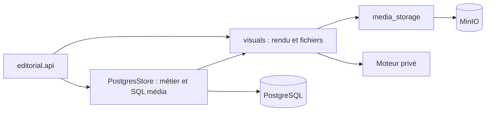
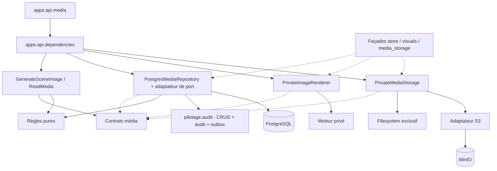

# Architecture média appliquée — Arvor

État au 18 octobre 2026 ; base de travail `112475c25fa70e9922c58792f4398ba5842cc89d`, branche `fix/ARCH-MEDIA-01-decouplage-media`, PR #208. Implémentation et tests locaux, aucune MEP ni acceptation éditoriale. Le SHA final et ses résultats sont consignés dans la PR ; les preuves historiques ne couvrent pas automatiquement un commit ultérieur.

## Frontières effectives

| Propriétaire | Responsabilité |
|---|---|
| `editorial/media/contracts.py` | Identity, ImageRequest, StoredAsset, erreurs et ports MediaRepository/ImageRenderer/MediaStorage/MediaCapacity ; aucune dépendance à un framework ou SDK. |
| `editorial/media/application.py` | GenerateSceneImage : approbation, préflight, réservation, rendu unique, stockage, confirmation DB, nettoyage après confirmation et gestion des états incertains. ReadMedia : catalogue, lecture privée et vérification. |
| `editorial/media_rules.py` | Source unique des personnages, prompts, provenance, limites PNG et politique d’URL privée. Règles pures conservées, sans duplication dans les adaptateurs. |
| `infrastructure/persistence/media_repository.py` | Les neuf méthodes/helper SQL média extraites de PostgresStore ; connexion et writer audit injectés. ImageRepositoryAdapter traduit psycopg.Error en erreur de port, sans exposer d’exception brute. |
| `infrastructure/images/sdcpp.py` | Transport HTTP privé, délai et taille bornés, refus des redirections et validation PNG. Le contrat compatible ne prouve pas un moteur/GPU actif. |
| `infrastructure/media/filesystem.py` | Chemins privés, création exclusive, lecture bornée et refus des symlinks. |
| `infrastructure/media/s3.py` | Client boto3 privé, PUT conditionnel, empreinte et version, lecture contrôlée ; aucun retry ambigu ni suppression d’objet automatique. |
| `infrastructure/media/images.py` | Sélection disque/MinIO, fichier de reprise et reçus de stockage ; suppression de la seule copie de reprise après acquittement DB. |
| `infrastructure/media/capacity.py` | Sémaphore image historique, partagé par les façades et la composition, toujours local au processus. |
| `apps/api/dependencies.py` | Assemblage des ports et adaptateurs concrets ; client HTTP existant partagé, pas de nouveau client/service réseau. |
| `apps/api/media.py` | Cinq routes média, identité authentifiée et mapping précis erreurs → statuts/en-têtes HTTP. Aucun SQL ni appel SDK. |

Les chemins détaillés du plan initial étaient des cibles illustratives. Le module neutre media_rules est conservé comme source canonique au lieu de redéplacer règles/PNG dans plusieurs wrappers. Les fonctions historiques de visuals et media_storage sont des réexports, pas des copies. PostgresStore conserve ses signatures en déléguant les opérations média au dépôt extrait ; les nouvelles routes utilisent directement ce dépôt via les ports. Ses autres opérations éditoriales restent dans le store historique.

## Avant / après

Avant cette extraction, sur la base 112475c (cycle visuals/media_storage déjà supprimé par la première étape) :

Après : flèches pleines = dépendance, pointillées = implémentation d’un port ou façade de compatibilité.

Le graphe Graphify est reconstruit localement. Les tests AST contrôlent les imports effectifs : aucun import apps/infrastructure/FastAPI/psycopg/HTTPX/boto3 dans le nouveau domaine média ; aucun réimport des façades par les adaptateurs ; aucun cycle entre ces modules. La proximité d’un nœud Graphify n’est pas une preuve d’appel métier.

Mesures de structure sur les deux arbres sources : `generate_image` passe de 76 à 7 lignes ; les sites d’exécution SQL des méthodes média dans PostgresStore passent de 11 à 0, déplacés dans un propriétaire unique. Cela mesure la séparation des responsabilités, pas un gain de performance ni une baisse du nombre total d’arêtes : l’introduction de ports augmente certains liens explicites.

## Transactions, concurrence et reprise

La réservation recharge le traitement sous verrou et vérifie approbation/non-périmé, scène attendue et prompt exact. L’asset garde son UUID déterministe et ne peut être réservé deux fois. CRUD, audit et outbox utilisent le writer existant dans une transaction.

Une course préexistante a été reproduite : finish_image pouvait lire l’approbation sans attendre une invalidation en cours. Le dépôt extrait verrouille désormais le traitement avant l’asset, dans le même ordre que réservation/revue. Il revérifie le scénario et l’état approuvé avant la mutation auditée. Ce verrou n’englobe jamais le moteur, le disque ou MinIO. Voir la fiche MCO dédiée et le test de concurrence PostgreSQL RED puis GREEN.

Le service n’effectue aucun retry implicite. Un timeout moteur/upload ou une perte d’acquittement DB reste incertain. Après stockage, la finalisation doit réussir avant tout nettoyage du fichier de reprise ; un échec de nettoyage après commit confirmé ne transforme pas un succès en erreur. Une exception inattendue ne déclenche ni régénération, ni écriture compensatoire qui pourrait masquer un commit réussi. Les threads d’IO conservent la protection d’annulation anyio utilisée historiquement par Starlette.

Les écritures disque et MinIO gardent une création exclusive. La copie locale de reprise MinIO utilise désormais le même writer exclusif en mode 0600 que le backend disque. Les en-têtes privés des téléchargements, l’enveloppe du catalogue et les statuts/API restent inchangés. Les mocks de tests ont été déplacés vers les nouveaux propriétaires, sans retirer d’assertion.

## Validation et limites

Contrôles : régression historique Linux, PostgreSQL 16 jetable, tests du service sans FastAPI/SDK, frontières d’import, réservations concurrentes, écrivains disque concurrents, ancienne réservation après redémarrage, invalidation d’approbation pendant finalisation, erreurs MinIO simulées, pertes d’acquittement DB et vérification de l’audit/outbox. Les parcours Studio utilisent le Chrome portable sur Ubuntu 26.04 et la fixture API simulée décrits dans le dossier QA local. Le SHA final et les compteurs finaux sont attachés à la PR.

Aucun changement de dépendance runtime, schéma, configuration de production, serveur d’images, worker ou export vidéo. Aucun déploiement réalisé. MinIO et moteur sont simulés dans les tests : aucune preuve de recette MinIO réelle, GPU ou qualité artistique. Le sémaphore reste local au processus ; ce lot ne qualifie pas une réplication multiworker de l’API. Le fournisseur texte historique reste hors du périmètre média de ce lot.

La CI GitHub et ses contrôles requis restent une condition de fusion ; les succès locaux ne contournent pas un blocage administratif. Les tests Python 3.12 ne sont pas revendiqués localement. Aucune fusion ni MEP sans validation explicite. Reprise par retour de code compatible, sans migration et sans suppression de média ; les anciens imports et références sont conservés. Les définitions Python changent de module : compatibilité pickle interversion non revendiquée.

Liste des fichiers : modules propriétaires ci-dessus, façades editorial/api.py, store.py, visuals.py, media_storage.py et image_verification.py, tests/test_media_application.py, test_media_boundaries.py, test_media_storage.py, test_visuals.py, test_qa_lot1.py, documentation de plan/MCO. Les __init__.py ajoutés déclarent les packages ; aucun fichier temporaire Graphify n’est commité.

Dernière validation de l’arbre média avant commit : 286 tests historiques/unitaires/PostgreSQL réussis, 0 erreur/échec/skip ; 12 parcours Studio réussis. Les cinq tests de frontières et la syntaxe/compilation sont inclus ou contrôlés séparément. La preuve terminale sera relancée et liée au SHA final dans la PR.

## Intégration avec main — 19 octobre 2026

Le main d08fe0afe62f0ea209da239aeade0bd5f042d30d est intégré uniquement dans la branche de travail. Les trois conflits ont été résolus : AGENTS.md est conservé octet pour octet depuis le commit utilisateur 112475c ; les routes conservent la lecture de secrets via runtime_secrets ; cette lecture est aussi transférée dans le propriétaire S3 extrait. Aucune fusion vers main et aucune activation PC. Le code final doit être revu notamment sur ces résolutions.

Régression de l’arbre intégré : 315 tests réussis sans échec/erreur/skip. Les cinq tests de frontières réussissent ; syntaxe JavaScript et compilation Python valides. Graphify est reconstruit localement et reste hors commit. La validation navigateur et la relance terminale au SHA final sont reportées dans la PR. Les résultats 286/12 précédents concernent le code avant intégration ; ils ne sont pas assimilés à une preuve sur un futur commit.

Recette navigateur de l’arbre intégré : 17 parcours Studio réussis, 0 erreur/échec/skip, sur fixture API simulée et Chrome portable. Le nombre diffère des 12 parcours antérieurs car les tests récents de main sont maintenant inclus.
